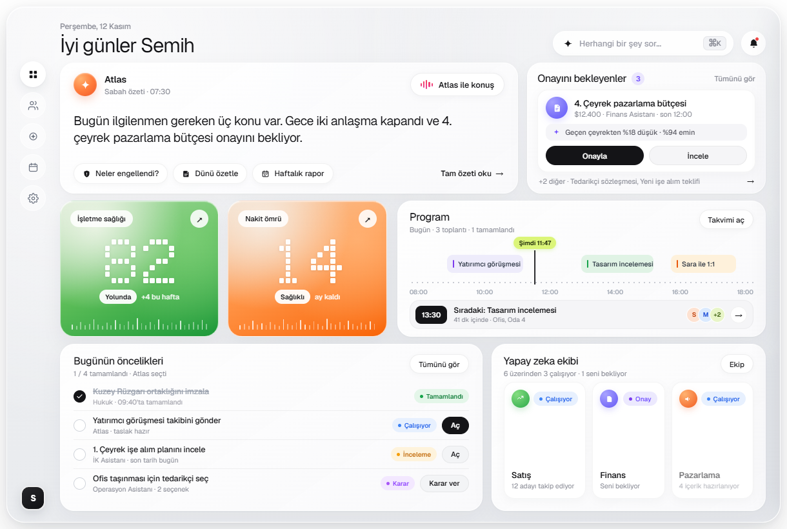

# Atlas Dashboard



A frameless, rounded-corner **Electron** executive workspace desktop application featuring glassmorphic Bento cards, offline bundled variable typography (`Geist Variable` & `Inter Variable`), smooth startup animations, and contextual micro-interactions inspired by modern AI assistant interfaces.

---

## Highlights

- **Frameless Rounded Desktop Shell** — Transparent `1220×820` Electron window (`frame: false`, `transparent: true`, `thickFrame: false`) with custom `28px` rounded corners, ambient soft-gray backdrop, draggable header, and hover-only window controls (`–`, `□`, `×`).
- **Offline Variable Fonts** — Locally bundled `@fontsource-variable/geist` and `@fontsource-variable/inter` (full `latin-ext` Turkish glyph support) so typography renders identically across machines without system font fallbacks.
- **Command Search (`⌘K` / `Ctrl+K`)** — Focusing the top search pill opens suggested prompts (`Bugün neler engellendi?`, `Dünü özetle`, `Gelecek ayın nakit akışını göster`) and renders inline Atlas response cards.
- **Morning Brief Card (`Atlas`)** — Includes an animated voice waveform button (`Atlas ile konuş`), interactive prompt pills (`Neler engellendi?`, `Dünü özetle`, `Haftalık rapor`), and full-brief expansion (`Tam özeti oku →`).
- **Approvals & Slide-Over Review Drawer (`Onayını bekleyenler`)** — Cycle through queued items, approve in one click, or open **İncele** for a slide-over breakdown drawer (AI rationale checklist, stacked category bar, attachment metadata) plus an undoable bottom toast notification (`Geri Al`).
- **Dot-Matrix Gradient KPIs (`İşletme sağlığı` & `Nakit ömrü`)** — Animated pixel-grid numeric matrices (`82` and `14`) with mesh gradients and sparkline tick rulers.
- **Schedule Timeline (`Program`)** — `08:00 – 18:00` dotted timeline with a live `Şimdi 11:47` vertical marker, next-meeting banner (`13:30`), and dark floating detail tooltips on event hover.
- **Today's Priorities & AI Team (`Bugünün öncelikleri` & `Yapay zeka ekibi`)** — Interactive checklist that updates completion counts in real time alongside agent cards (`Satış`, `Finans`, `Pazarlama`) with dark hover progress tooltips.

---

## Tech Stack

| Layer | Technology |
| --- | --- |
| Desktop Runtime | [Electron](https://www.electronjs.org/) `^35.0.0` |
| Typography | `@fontsource-variable/geist` `^5.3.0`, `@fontsource-variable/inter` `^5.3.0` |
| UI & Logic | HTML5, CSS3 (Grid, Flexbox, Backdrop Blur, Keyframes), Vanilla JavaScript |
| IPC Bridge | Context-isolated `preload.js` (`contextIsolation: true`, `nodeIntegration: false`) |

---

## Quick Start

### Prerequisites

- [Node.js](https://nodejs.org/) (v18+ recommended)
- npm

### Installation & Run

```bash
git clone https://github.com/semihergili/atlas-dashboard-copy.git
cd atlas-dashboard-copy
npm install
npm start
```

> **Windows PowerShell note:** Use `;` instead of `&&` when chaining commands in PowerShell 5.1:
> ```powershell
> cd atlas-dashboard-copy; npm install; npm start
> ```

---

## Keyboard Shortcuts & Interactions

| Trigger | Action |
| --- | --- |
| `Ctrl+K` / `⌘K` | Focus search bar and open prompt suggestions |
| `Escape` | Close search popover or slide-over review drawer |
| Click `İncele` | Open budget/contract breakdown drawer |
| Click `Onayla` | Approve active request with `Geri Al` undo toast |
| Hover timeline / AI cards | Reveal dark contextual status & progress tooltips |
| Click priority checkbox | Toggle task completion and update summary counter |

---

## Project Structure

```text
atlas-dashboard-copy/
├── assets/
│   └── verify_dashboard.png   # Live Electron render preview
├── index.html                 # Dashboard layout, popovers, drawer & toast markup
├── main.js                    # Frameless transparent Electron window & IPC handlers
├── preload.js                 # Context-isolated window control bridge (dashboardAPI)
├── renderer.js                # Dot-matrix KPI renderer, drawer state, tooltips & search
├── styles.css                 # Bento grid, mesh gradients, typography & animations
├── package.json               # Dependencies and Electron launch script
├── .gitignore
└── README.md
```
